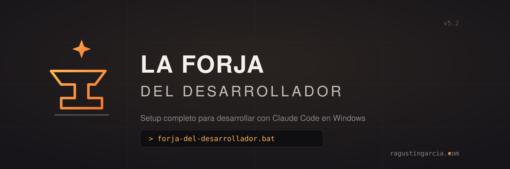

# La Forja del Desarrollador

> Setup completo para desarrollar con Claude Code en Windows.  
> 21 herramientas instaladas, configuradas y vinculadas en un solo script.

[](LICENSE)
[](https://github.com/ragustingarcia/la-forja-del-desarrollador)
[](https://ragustingarcia.com/)

---

## Qué hace

Un `.bat` que corre como Administrador, instala todo lo que necesitás para desarrollar con Claude Code en Windows, y te guía paso a paso para conectar cada servicio.

Si algo ya está instalado, lo detecta y lo saltea. Si algo falla, te dice qué hacer. Podés correrlo múltiples veces sin romper nada.

---

## Cómo usarlo

```
1. Descargá forja-del-desarrollador.bat
2. Click derecho → "Ejecutar como administrador"
3. Seguí las instrucciones en pantalla
```

Si Windows bloquea el script, click en "Más información" → "Ejecutar de todas formas".

---

## Qué instala

### Infraestructura
| # | Herramienta | Para qué |
|---|---|---|
| 1 | winget | Gestor de paquetes de Windows |
| 2 | PowerShell 7 | Terminal moderna (el script corre en pwsh) |
| 3 | WSL | Linux dentro de Windows (necesario para Docker) |
| 4 | Git | Control de versiones + configura nombre y email |

### Lenguajes
| # | Herramienta | Para qué |
|---|---|---|
| 5 | Node.js LTS | JavaScript del lado del servidor + npm |
| 6 | pnpm | Alternativa a npm: más rápido, menos disco |
| 7 | Python 3.13 | Backend, IA, automatización |
| 8 | Libs Python | fastapi, uvicorn, python-multipart, pdfplumber, requests |

### Desarrollo
| # | Herramienta | Para qué |
|---|---|---|
| 9 | VS Code | Editor de código |
| 10 | Claude Code CLI | IA que desarrolla con vos (herramienta central) |
| 11 | Claude Desktop | App de escritorio de Claude |
| 12 | GitHub CLI | Gestionar repos, PRs e issues desde terminal |

### Servicios
| # | Herramienta | Para qué |
|---|---|---|
| 13 | Docker Desktop | Contenedores (necesario para Supabase local) |
| 14 | mongosh | Cliente de MongoDB |
| 15 | Ollama | Modelos de IA locales (Llama, Mistral, Gemma) |
| 16 | FFmpeg | Procesamiento de audio y video |

### Deploy y seguridad
| # | Herramienta | Para qué |
|---|---|---|
| 17 | Netlify CLI | Deploy de frontends y sitios estáticos |
| 18 | Vercel CLI | Deploy de apps Next.js y React |
| 19 | Supabase CLI | PostgreSQL, auth, storage y edge functions |
| 20 | Snyk CLI | Scanner de vulnerabilidades en dependencias |

### Vinculaciones
| # | Herramienta | Para qué |
|---|---|---|
| 21 | Asistente de conexión | Conecta GitHub CLI, Claude MCP, Netlify, Vercel, Supabase, Snyk y Docker con tu cuenta |

---

## Qué hace el paso 21 en particular

El asistente de vinculación verifica y conecta cada servicio:

- **GitHub CLI** → `gh auth login` (navegador)
- **Claude MCP GitHub** → configura `GITHUB_PERSONAL_ACCESS_TOKEN` como variable de entorno de usuario y registra el servidor `@modelcontextprotocol/server-github` en Claude Code
- **Netlify** → `netlify login` (navegador)
- **Vercel** → `vercel login` (navegador o email)
- **Supabase** → `supabase login` (navegador)
- **Snyk** → ingreso manual de API token
- **Docker** → verifica que Docker Desktop esté corriendo

Si ya estás conectado a algún servicio, el script lo detecta y lo marca como OK sin pedirte nada.

---

## Requisitos

- Windows 10/11
- Conexión a internet
- Cuenta en GitHub (para el paso de vinculación)
- Cuentas opcionales: Netlify, Vercel, Supabase, Snyk

---

## Notas

- Algunos pasos instalan programas que necesitan **reiniciar la terminal o la PC** para que el PATH se actualice. El script te avisa cuándo. Podés volver a correrlo después del reinicio para completar los pasos pendientes.
- Docker Desktop requiere reiniciar la PC después de instalarse.
- El script **no toca ni borra** lo que ya tenés instalado.
- El MCP de GitHub usa el servidor oficial `@modelcontextprotocol/server-github` vía NPX.

---

## Actualizar

Descargá la versión más reciente del script y volvé a correrlo. Detecta lo que ya está instalado y solo instala lo que falta.

---

## Historial de versiones

| Versión | Cambios |
|---|---|
| v5.1 | Verificación de Claude Code no interactiva (`claude doctor` colgaba el script), guard en la configuración de Git recién instalado, detección WSL por exit code (el output UTF-16 de wsl.exe rompía el parseo de texto), mensaje de éxito restaurado, URL de actualizaciones, kit de marca (banner, badges, CITATION.cff) |
| v5 | Python 3.13, pnpm, Supabase CLI via winget, MCP GitHub corregido (server-github oficial), configuración de identidad Git, detección WSL mejorada |
| v4 | Asistente interactivo de vinculación, detección de stubs de Python en WindowsApps |

---

## Autor

Hecho por **Rodolfo Agustín García** — [ragustingarcia.com](https://ragustingarcia.com/)

- GitHub: [@ragustingarcia](https://github.com/ragustingarcia)
- LinkedIn: [ragustingarcia](https://www.linkedin.com/in/ragustingarcia/)
- Lab: [rcwe.ragustingarcia.com](https://rcwe.ragustingarcia.com/)

Si te resultó útil, issues y PRs son bienvenidos. Para citar esta herramienta, usá el botón **"Cite this repository"** de GitHub (definido en [CITATION.cff](CITATION.cff)).

---

## Licencia

MIT — libre para usar, modificar y distribuir.
